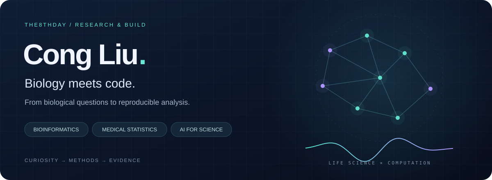
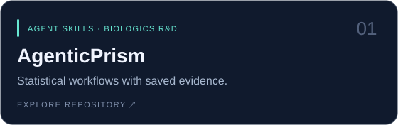
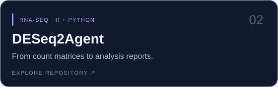
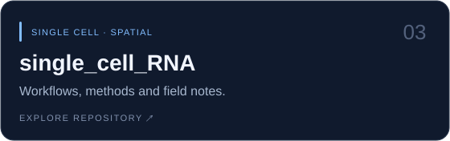
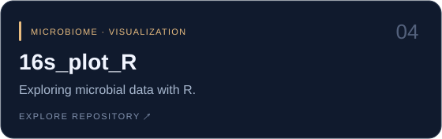

  

  <a href="#about">About</a> ·
  <a href="#selected-projects">Selected projects</a> ·
  <a href="#toolbox">Toolbox</a> ·
  <a href="https://github.com/the8thday?tab=repositories">All repositories ↗</a>

### Hi, I'm Cong 👋

I work at the intersection of **bioinformatics, medical statistics, and AI-assisted scientific analysis**. I build analysis workflows and tools that connect biological questions with code, interpretable results, and reproducible reports.

我关注生物信息学、医学统计与 AI 辅助科研，把分析经验沉淀成可复用的流程、工具和笔记。

🧬 **Explore biology** — bulk RNA-seq, single-cell and spatial transcriptomics. 
📐 **Make methods explicit** — statistical analysis for antibody and biologics research. 
🤖 **Build with agents** — turn analysis workflows into reusable scientific tools.

### Selected projects

<table>
<tr>
<td width="50%"></td>
<td width="50%"></td>
</tr>
<tr>
<td width="50%"></td>
<td width="50%"></td>
</tr>
</table>

**Currently building · [AgenticPrism](https://github.com/the8thday/AgenticPrism-SKILL)** 
Modular analysis skills for antibody and biologics R&D, with saved configurations, diagnostics, and reports. **Public beta for research use**; method-specific validation and limitations are documented in the repository.

### Toolbox

**Languages**　`R` · `Python` 
**Analysis**　`Seurat` · `Scanpy` · `DESeq2` · `SciPy` 
**Reporting & workflows**　`Quarto` · `R Markdown` · `Jupyter` · `Agent Skills`

---

  <b>Better questions. Clearer methods. Reproducible science.</b> 
  持续学习，认真分析，把好用的方法留下来。

